# CIGST — Manual de uso

*Cómo se usa la plataforma en el día a día, sin tecnicismos. La versión
completa con capturas está en [PDF](Manual-de-uso-CIGST.pdf) para imprimir o
compartir. Si todavía no la instalaste, ver antes
[Cómo descargar](Como-descargar-CIGST.pdf) y [Cómo instalar](Como-instalar-CIGST.pdf).*

> 🆕 **Nuevo en esta versión: [Unidades de red](#unidades-de-red-nuevo).** Las
> carpetas compartidas de la empresa, dentro de la plataforma: ver, descargar,
> subir y eliminar archivos sin mapear nada en Windows.

---

## ¿Qué es CIGST?

CIGST es la plataforma interna de soporte técnico de la empresa: tickets,
personas, equipos, sectores, chat interno con grupos, notificaciones, correo y
las carpetas compartidas de la red — todo en un solo lugar. **Funciona solo dentro de la red de la empresa**: nada de
lo que se carga sale a internet.

---

## Cómo se instala (una sola vez, en un solo equipo)

1. Descargar la carpeta del proyecto.
2. **Windows**: doble click en `install.bat` — **Linux/Mac**: `./install.sh`
3. Elegir la opción **1** del menú y responder las preguntas (o Enter para
   valores seguros por defecto).

Al terminar, el instalador muestra la dirección para entrar (por ejemplo
`http://servidor:3000`). El resto del personal solo necesita esa dirección y
su navegador: no instala nada.

---

## Entrar a la plataforma

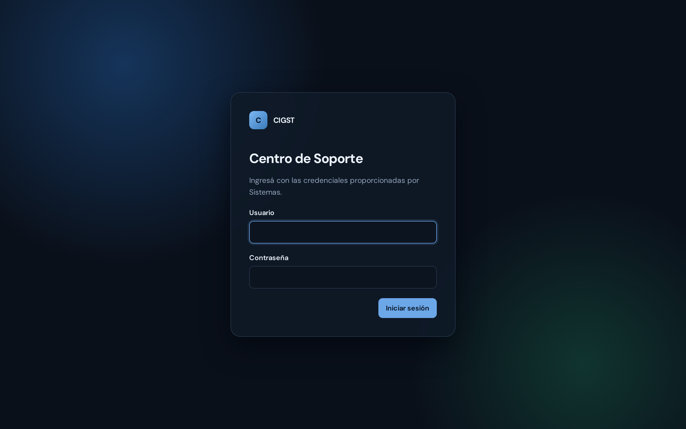

Abrí el navegador, escribí la dirección que te pasó Sistemas, y entrá con tu
usuario y contraseña. ¿La olvidaste? Un Administrador te asigna una nueva
desde el Panel administrador.

---

## Los tres rangos y sus permisos

| Rango | Qué puede hacer |
| --- | --- |
| **Administrador** | Todo: crea y edita personas, usuarios, equipos, sectores y turnos (cada edición deja registro de cambios), gestiona tickets, usa el chat, crea los grupos, publica en Novedades, crea bases de conocimiento y define sus permisos. 🆕 **Vincula y asigna las unidades de red.** Es el único que ve Bitácora técnica y Panel administrador. |
| **Supervisor** | Ve todo el trabajo de soporte y lo opera: crea y gestiona tickets de cualquiera. **Publica en Novedades** (y administra lo suyo). Ve personas, equipos y sectores con sus historiales, pero **no puede crear ni editar** esos catálogos. 🆕 Usa las **unidades de red que le asignaron**. No ve Bitácora ni Panel administrador. |
| **User** | Crea tickets para sí mismo o para cualquier persona (con adjuntos) y ve solo sus propias solicitudes. Usa el chat (1 a 1 y los grupos donde lo agregaron). **Lee Novedades y comenta**, pero no publica. Entra a las **bases de conocimiento a las que le dieron permiso**. 🆕 Usa las **unidades de red que le asignaron**. |

Los permisos se controlan en el servidor: lo que tu rango no permite, la
plataforma lo rechaza aunque se intente por otra vía.

---

## Ordenar y buscar en cualquier lista

Esto vale para **todas** las listas de la plataforma: Tickets, Personas,
Equipos y espacios, Sectores, Turnos y el Panel administrador.

- **Ordenar**: hacé clic en el título de una columna y la lista se ordena por
  ella; un segundo clic la invierte. La flecha ▲ / ▼ muestra por cuál está
  ordenada y en qué sentido.
- **Buscar**: el casillero de arriba filtra a medida que escribís, y el orden
  que elegiste se mantiene.

El orden alfabético es **el que uno espera**, no el de la computadora: no
distingue mayúsculas de minúsculas, ubica los acentos y la ñ donde
corresponde en castellano ("Ávila" va junto a "Ana", no al final), y compara
los números por valor — *Consultorio 3* antes que *Consultorio 213*.

Dos columnas se ordenan por su propio criterio en vez del abecedario, porque
es lo útil: **Prioridad** va de Crítica a Baja, y **Estado** sigue el avance
del ticket (Nuevo → … → Cerrado).

**Los desplegables de los formularios** también vienen ordenados
alfabéticamente con el mismo criterio, así no hay que buscar a alguien en
una lista desordenada.

### Listas largas: el paginador

Cuando una lista supera las 50 filas aparece abajo una barra con **‹ Anterior**
y **Siguiente ›**, y en el medio dice en qué parte del total estás
(*"51–100 de 3.482"*).

Lo importante es que **el orden y la búsqueda trabajan sobre el total, no
sobre la página que estás viendo**. Si ordenás por nombre, la primera página
trae los primeros del abecedario entre *todos* los registros; si buscás
"impresora", encuentra todas las que haya, estén en la página que estén. Al
cambiar el orden o escribir en el buscador, la lista vuelve sola a la
primera página.

Esto es lo que permite que la plataforma siga siendo rápida con miles de
tickets acumulados: el servidor manda de a una página en vez de la tabla
entera.

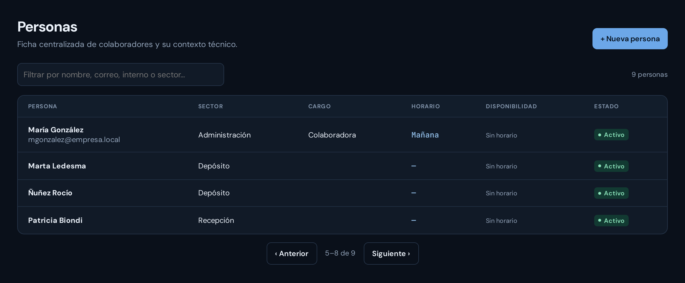

---

## Ver la dirección de red de tu computadora (botón "Mi IP")

Arriba a la derecha, al lado del botón **Salir**, hay un botón que dice
**Mi IP**.

Sirve para lo de siempre: llamás a sistemas por un problema y lo primero que
te preguntan es "¿qué IP tenés?". En vez de explicarte por teléfono cómo
abrir una consola, apretás ese botón y ahí está. Al técnico además le sirve
para conectarse a tu máquina por VNC y ver el problema con sus propios ojos.

- **Está oculta por defecto, a propósito.** Una dirección interna es
  información de infraestructura: no tiene por qué estar a la vista mientras
  compartís pantalla en una reunión o mientras pasa gente por detrás de tu
  escritorio. Se muestra solo cuando la pedís, y el mismo botón la vuelve a
  ocultar.
- **Cada persona ve únicamente la suya.** No hay forma de consultar la
  dirección de otro: la plataforma la deduce de tu propia conexión, no de
  una lista.
- **Un clic sobre la dirección la copia**, así la pegás directo en el chat
  o en el visor de VNC.

---

## Novedades: el tablero de la empresa

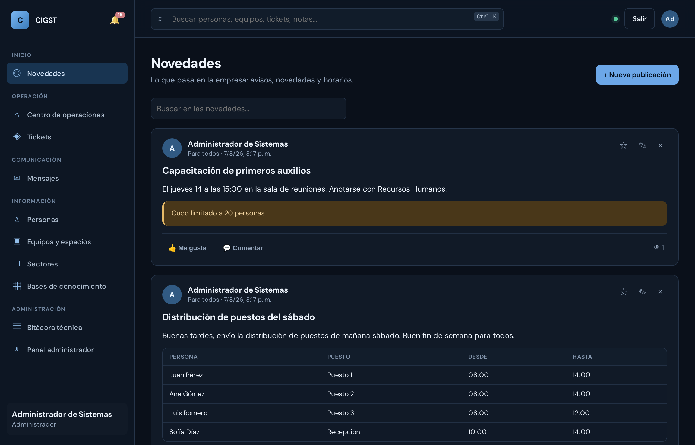

Es la pantalla con la que se entra. Ahí aparecen los avisos, las novedades y
los horarios: quién cubre cada puesto el sábado, un cambio de proveedor, una
capacitación.

**Publican Administradores y Supervisores. Lee todo el personal.**

### Escribir una publicación

**+ Nueva publicación** → título, para quién es, y el contenido. El contenido
se arma con **bloques**, y se agregan los que hagan falta:

| Bloque | Para qué |
|---|---|
| **Texto** | Un párrafo común. |
| **Título** | Para separar partes largas. |
| **Tabla** | La grilla de puestos, un cuadro de guardias, cualquier planilla. |
| **Lista** | Puntos o pasos numerados. |
| **Imagen** | Una foto o una captura. |
| **Archivo** | Un PDF o una planilla para descargar. |
| **Aviso** | Un recuadro de color para lo importante. |
| **Enlace** | Un link a un sistema o a un portal. |
| **Tarjeta de datos** | Un bloque con datos etiquetados (más usado en las bases). |

> **La grilla del sábado, sin sufrir.** Agregá un bloque de **Tabla** y
> **pegá directamente desde Excel** en cualquier casillero: la tabla se
> completa sola, con la primera fila como encabezado. No hace falta cargar
> celda por celda ni mandar una captura de pantalla.

**Para quién es**: *Toda la empresa* o *Solo algunos sectores*. Si elegís
sectores, la publicación **no le aparece a nadie más** — ni en la lista ni
entrando por el enlace directo.

### Leer, comentar y reaccionar

Cualquier persona puede **comentar** y poner **👍 Me gusta** en lo que ve.
El **👁 con un número** dice cuántos la leyeron; tocándolo se ve quiénes.

Quien publicó (y un Administrador) puede **fijarla arriba** con la estrella
⭐, editarla o eliminarla. Las fijadas siempre quedan primeras.

Todo esto es **en tiempo real**: una publicación nueva, un comentario o un
"me gusta" aparecen solos, sin recargar.

---

## Correo

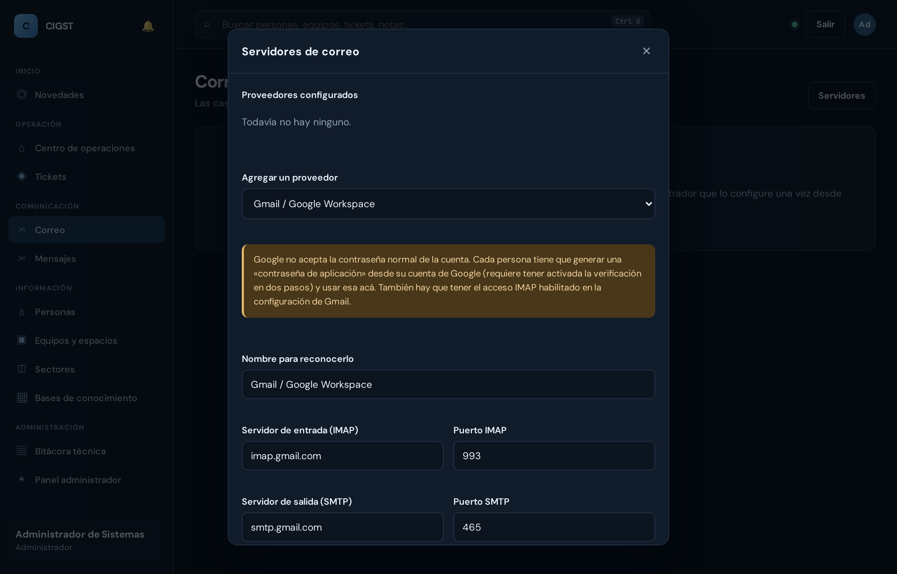

Las casillas que ya usa la empresa, **dentro de la plataforma**. La idea es
simple: si en recepción se usan dos correos —el propio y el del sector— no
haga falta tener dos pestañas abiertas.

### Agregar tu casilla

**Correo → Mis casillas** → elegís el proveedor, ponés tu dirección y tu
contraseña. La plataforma **prueba la conexión antes de guardar**: si algo
está mal te lo dice en el momento, con lo que hay que revisar.

> **Ojo con Gmail y Yahoo:** no aceptan la contraseña normal de la cuenta.
> Hay que generar una **«contraseña de aplicación»** desde la cuenta (requiere
> tener activada la verificación en dos pasos) y usar esa. La plataforma te lo
> avisa en pantalla al elegir el proveedor.

### Casillas compartidas del sector

Un Administrador puede agregar una casilla como **compartida** (recepción@,
turnos@) y darle acceso a un sector completo o a personas puntuales. Quien
tenga acceso la ve en el mismo selector, al lado de la suya.

### Usar el correo

Carpetas a la izquierda, correos a la derecha. Se puede leer, **responder**,
**escribir** uno nuevo con adjuntos, y **eliminar** (va a la papelera de la
casilla, no se borra de verdad). El buscador busca en el servidor, así que
encuentra también en correos viejos que no están a la vista.

> **Las imágenes de los correos vienen bloqueadas.** No es capricho: muchas
> son un píxel invisible que le avisa a quien te escribió que abriste el
> correo, a qué hora y desde qué red. Si el correo es de confianza, hay un
> botón para mostrarlas.

### Si te pide volver a escribir la contraseña de una casilla

Alguna vez puede aparecer un aviso arriba de la pantalla de Correo diciendo que
una o más casillas **necesitan que vuelvas a escribir su contraseña**.

Lo que pasó: las contraseñas de las casillas se guardan cifradas con una clave
del servidor. Si esa clave cambió —lo típico es que hayan restaurado una copia
de seguridad en un servidor nuevo— la plataforma ya no puede leerlas.

Lo importante: **no se perdió ningún correo**. Los mensajes viven en el servidor
de tu proveedor (Gmail, el de la empresa, el que sea), no dentro de la
plataforma. Lo único que hay que hacer es entrar a *Mis casillas* y volver a
cargar la contraseña de cada una que aparezca marcada.

Antes de este aviso, uno se enteraba casilla por casilla y con un error distinto
cada vez, sin entender el motivo.

### Lo que la plataforma NO hace

No es un servidor de correo. **No recibe correo de internet y no abre ningún
puerto**: se conecta hacia afuera al proveedor, igual que Outlook desde
cualquier PC. Tampoco guarda los correos en su base de datos — los pide al
proveedor cuando hacen falta y los descarta.

---

## Unidades de red (Nuevo)

> 🆕 **Nuevo en esta versión — en pocas palabras**
>
> - **Qué hace:** te muestra las carpetas compartidas de la empresa adentro de
>   CIGST, para descargar, subir y eliminar archivos sin mapear nada en Windows.
> - **Cómo se usa:** *Unidades de red* en el menú. Ves las unidades que un
>   Administrador te asignó. Para eliminar un archivo te pide la contraseña de
>   la unidad.
> - **Cómo está hecho:** CIGST se conecta al servidor de archivos igual que lo
>   hace Windows, cada vez que abrís una carpeta. No guarda copias: lo que ves
>   es lo que hay en el servidor en ese momento.

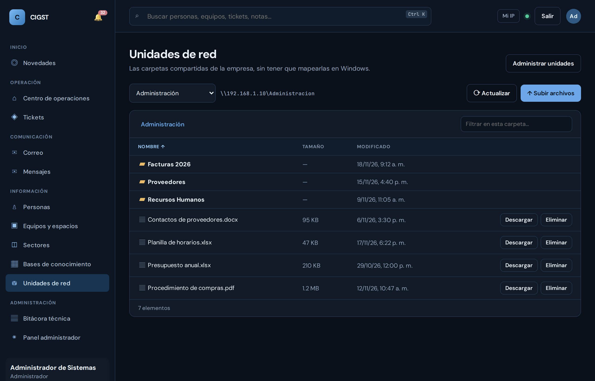

Las carpetas compartidas de la empresa (las que en Windows se "mapean" como
`Z:` o se abren con `\\servidor\carpeta`), **dentro de la plataforma**. Sirven
para ver, descargar, subir y eliminar archivos desde cualquier computadora de la
red, sin tener que mapear la unidad en Windows ni saber la ruta.

Lo importante es que **no es una copia**: cada vez que abrís una carpeta, la
plataforma la lee del servidor de archivos en ese momento, y lo que subís se
guarda directamente ahí. Lo que ves en CIGST es exactamente lo mismo que se ve
desde el Explorador de Windows, en el mismo instante.

### Usar una unidad

**Unidades de red** en el menú. Si tenés más de una, se elige arriba a la
izquierda.

- **Abrir una carpeta:** clic en la fila. Para volver, la ruta de arriba
  (`Contabilidad › Informes 2026`) es clickeable, o la fila «Subir un nivel».
- **Descargar:** botón *Descargar* en la fila del archivo.
- **Subir:** botón *Subir archivos*, o **arrastrá los archivos desde el
  Explorador** y soltalos sobre la carpeta abierta. Se ve el avance de cada uno.
  Si tenés una subida en curso y querés cerrar la pestaña, el navegador te avisa.
- **Eliminar:** botón *Eliminar* en la fila del archivo. **Pide la contraseña
  de la unidad de red** (no la de CIGST): es la confirmación real de quién está
  eliminando. El cuadro te dice de qué usuario es la contraseña que te pide.
- **Actualizar:** si alguien acaba de agregar algo desde Windows, el botón
  *Actualizar* vuelve a leer la carpeta.

> **Los archivos no se sobreescriben nunca.** Si subís un archivo con un nombre
> que ya existe en esa carpeta, la plataforma te avisa y no lo sube. Para
> subirlo, eliminá el que está en la unidad o cambiale el nombre al tuyo.

> **Eliminar es de verdad.** El archivo se borra del servidor de archivos para
> todos los que usan esa unidad, también desde Windows. La plataforma no tiene
> papelera de reciclaje para las unidades de red.

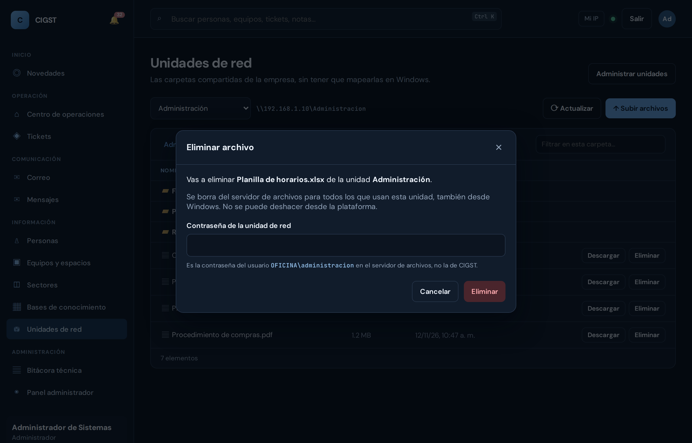

Si escribís mal la contraseña cinco veces seguidas, hay que esperar 15 minutos.
Es a propósito: muchos servidores de archivos **bloquean al usuario** después de
varios intentos fallidos, y eso dejaría sin acceso a todos los que usan la unidad.

### Si no ves ninguna unidad

Las unidades las asigna un Administrador. Pedile que te asigne las carpetas que
necesitás.

### Vincular y asignar unidades (solo Administradores)

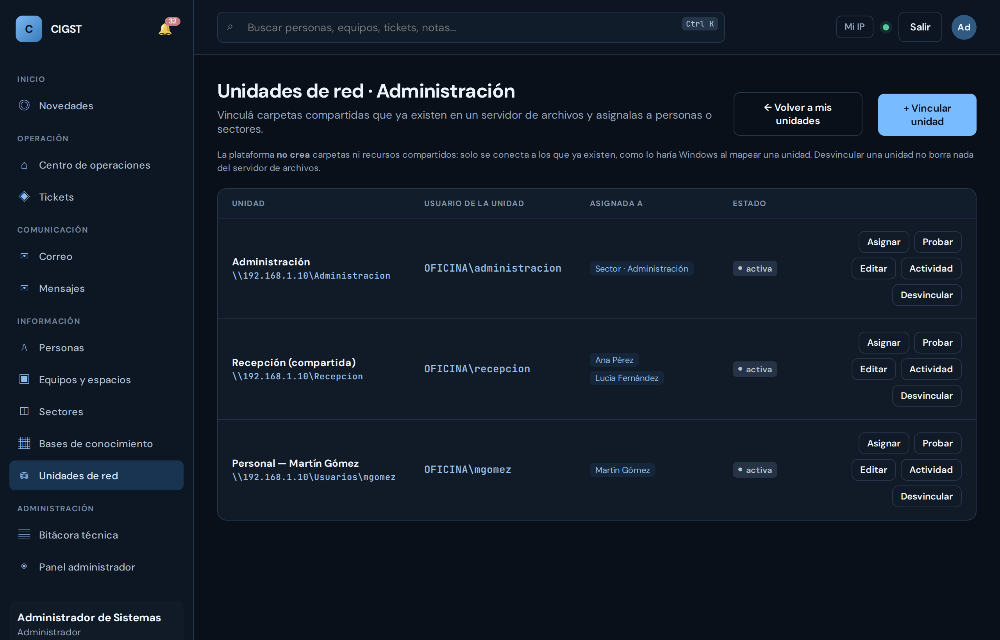

**Unidades de red → Administrar unidades → + Vincular unidad.** Se completan:

| Campo | Qué poner |
| --- | --- |
| Nombre | Cómo la van a ver las personas: *Contabilidad*, *Mis documentos* |
| Ruta | Tal como se escribe en el Explorador: `\\192.168.1.10\Contabilidad` |
| Usuario y contraseña | Los **del servidor de archivos**, no los de CIGST |
| Dominio o grupo de trabajo | Opcional. También se puede escribir el usuario como `DOMINIO\usuario` |

La plataforma **prueba la conexión antes de guardar**: si la ruta, el usuario o
la contraseña están mal, te lo dice en el momento. Al guardar se abre directo la
pantalla para **asignarla**:

- A **una persona**: es su unidad personal.
- A **varias personas o a un sector**: es una unidad compartida. Todos entran
  con el mismo usuario de la unidad, y para eliminar archivos necesitan conocer
  esa contraseña.

> **Usá la dirección IP del servidor**, no su nombre. Un nombre como
> `\\SERVIDOR` solo funciona si el DNS de la red lo conoce; Windows a veces lo
> encuentra por otros medios que la plataforma no puede usar.

> **La ruta puede apuntar a una subcarpeta**
> (`\\192.168.1.10\Compartido\Contabilidad`). Quien la use solo ve esa parte y
> no puede salir de ahí.

Desde la misma pantalla:

- **Probar:** comprueba que la unidad sigue respondiendo con la contraseña
  guardada. Si la contraseña cambió en el servidor, la unidad queda marcada con
  error hasta que se cargue la nueva en *Editar*.
- **Actividad:** quién subió y quién eliminó qué, y cuándo, incluidos los
  intentos de eliminar con la contraseña equivocada. Muestra lo que se hizo
  desde la plataforma; lo que se hace directamente desde Windows no aparece.
- **Desvincular:** la saca de la plataforma. **No borra nada del servidor de
  archivos**: las carpetas y los archivos siguen exactamente donde estaban.

Un Administrador **no ve el contenido** de una unidad por el solo hecho de ser
Administrador, igual que no lee los chats ni el correo ajeno: configura, no
mira. Si la necesita usar, se la asigna a sí mismo.

### Lo que la plataforma NO hace

**No crea carpetas compartidas ni recursos en el servidor de archivos.** Solo se
conecta a las que ya existen, como haría Windows al mapear una unidad. El
tamaño máximo de los archivos, las cuotas y los permisos de cada carpeta los
sigue decidiendo quien administra el servidor de archivos: si ese usuario no
puede escribir en una carpeta desde Windows, tampoco puede desde CIGST.

---

## Bases de conocimiento

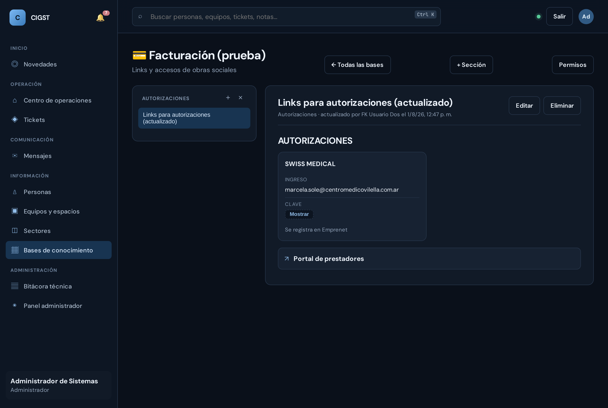

Acá vive lo que hoy está en un Excel que circula por mail o en un cuaderno:
los accesos a las obras sociales, cómo se hace un procedimiento, los
instructivos de cada área.

**Cada área arma la suya.** Adentro hay **secciones** (por ejemplo
*Autorizaciones* dentro de *Facturación*) y adentro de cada sección, los
**artículos**.

### Quién ve qué

Un Administrador crea la base y define los permisos desde el botón
**Permisos**. Se puede dar acceso a:

- un **sector** completo (todo Facturación),
- un **rango** (todos los Supervisores),
- una **persona** puntual.

Y en dos niveles: **solo lectura** o **lectura y edición**.

> Quien no tiene permiso **no ve la base**: no aparece en la lista, y entrando
> por el enlace directo la plataforma responde que no existe. No es que se
> oculte el botón — el servidor directamente no la entrega.

### Escribir un artículo

Se arma con los mismos bloques que el feed. El más usado acá es la
**Tarjeta de datos**: título, logo opcional y una lista de datos etiquetados.
Es lo que sirve para armar una tarjeta por obra social con su usuario, su
clave y su nota.

### Usuarios y contraseñas compartidas

Al cargar un dato en una tarjeta se lo puede marcar como **Ocultar**. Ese
valor se muestra tapado, con un botón **Mostrar**, y no aparece en los
resultados de la búsqueda.

> Sirve para que la clave de una prepaga no quede a la vista de cualquiera que
> pase por detrás de la pantalla. **No es una caja fuerte**: quien tiene
> permiso de lectura puede revelarla. La protección real es a quién le das
> acceso a la base.

### Buscar

El casillero de arriba busca por título **y dentro del contenido**, pero solo
en las bases que vos podés ver.

---

## El Centro de operaciones

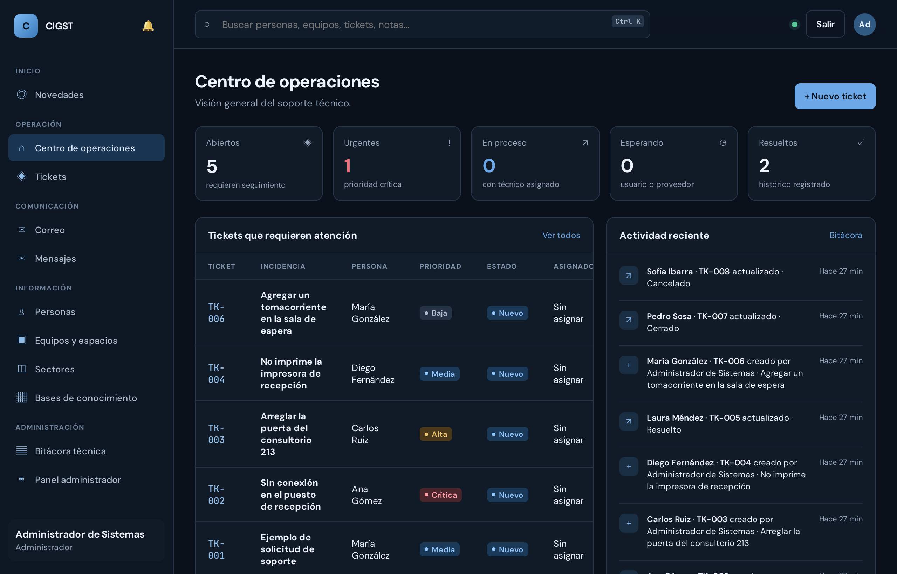

La pantalla principal del equipo de soporte: tickets abiertos, urgentes, en
proceso y la actividad reciente. En **Actividad reciente**, el nombre de la
persona y el código del ticket son clickeables y llevan directo a la ficha o
al ticket.

---

## Notificaciones (la campanita)

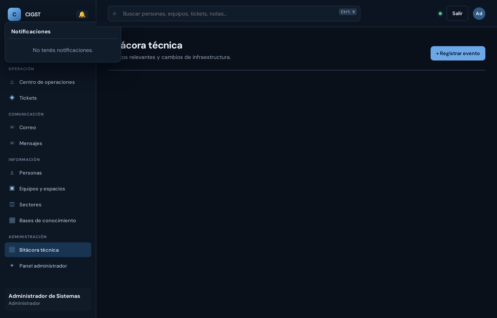

Arriba a la izquierda, al lado del logo, está la campanita 🔔 con el número
de notificaciones sin leer. Tocando una notificación vas directo a lo que te
avisa (el ticket, el grupo…) y queda marcada como leída. Llegan avisos por:
ticket nuevo (al equipo de soporte), cambio de estado de tu ticket, ticket
asignado a vos, y alta en un grupo de chat.

---

## Tickets

**Crear** (cualquier rango): + Nuevo ticket / + Solicitar soporte → elegí a
la **persona a asistir** (vos u otra persona), título breve, descripción, y
si corresponde el **equipo o espacio**.

Aparte va el **Sector a requerir**: a qué área le estás pidiendo la ayuda.
Es una decisión tuya y arranca vacío a propósito — **no** se deduce de dónde
está ubicada la persona ni el equipo. Alguien de Administración puede
pedirle a Mantenimiento por una PC que está en Depósito, y las tres cosas
son distintas. La **categoría** se arma con las que definió ese sector: si
cambiás el sector, cambia la lista. La fecha y hora se registran solas.

También podés **adjuntar archivos** (imágenes, PDF o planillas): hasta 5 por
ticket, de 10 MB cada uno. Es la forma más rápida de mostrar el problema —
una captura de pantalla vale más que tres párrafos de descripción.

> **Las fotos se achican solas.** Una foto de celular pesa entre 3 y 6 MB, y
> para ver una impresora rota no hace falta ni la décima parte. Al elegirla, el
> navegador la reduce antes de mandarla: ocupa unas **10 veces menos** en el
> servidor, se sube más rápido y se ve igual. Los PDF y las planillas no se
> tocan. Si la foto era muy pesada vas a ver un aviso diciendo cuánto bajó.

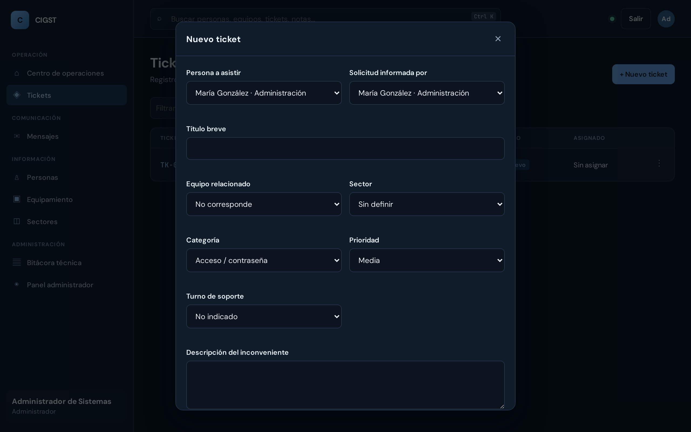

**Seguir y resolver** (Administrador y Supervisor): el detalle permite
cambiar estado, asignar responsable y anotar la solución; el menú ⋮ de cada
fila resuelve/cierra/asigna sin abrir nada. El ticket siempre muestra los
datos **actuales** del equipo involucrado, aunque haya cambiado después.

**Ocultar los cerrados.** Arriba de la lista hay un selector de estado que
arranca en **«Sin cerrados ni cancelados»**: en el día a día lo que importa
es lo que sigue abierto. Al lado se ve el conteo ("5 de 7") para saber
cuántos se están ocultando. Las otras opciones son *Todos los estados*,
*Solo cerrados* y cada estado por separado.

---

## Personas

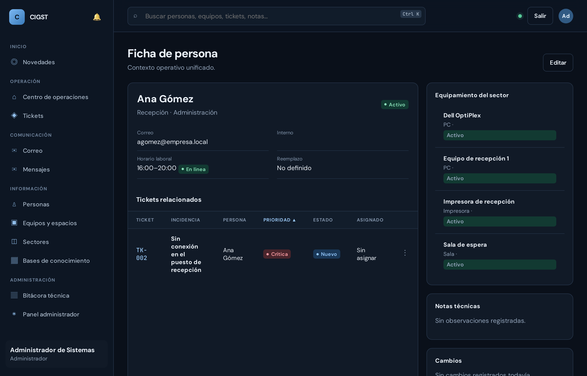

La ficha de cada colaborador: sector, contacto, horario, tickets y el
equipamiento de su sector (clickeable). **Crear y editar es del
Administrador**; cada edición deja una línea automática en el panel
**Cambios** de la ficha ("de X a Y", con fecha y hora).

### Horario laboral y disponibilidad

En la ficha se cargan **hora de entrada** y **hora de salida** eligiéndolas
de un reloj — no hay que escribir el horario a mano. Con eso la plataforma
muestra sola, en la lista y en la ficha, si la persona está:

| | |
|---|---|
| **En línea** | La hora actual cae dentro de su horario. |
| **Fuera de horario** | Tiene horario cargado, pero ahora no está. |
| **Sin horario** | Todavía no se le cargó ninguno. |

El cálculo lo hace el **servidor**, no la computadora de cada uno: todos ven
el mismo estado aunque tengan el reloj desajustado. Los **turnos que cruzan
la medianoche** funcionan igual (22:00 a 06:00 marca *en línea* a las 2 de
la mañana). Para dejar de mostrar disponibilidad, se borran las dos horas.

### Eliminar una persona

El botón **Eliminar** está dentro de *Editar* (solo Administrador). Los
**tickets que esa persona pidió no se borran**: siguen en la lista con su
nombre, para que no se pierda el historial.

---

## Equipos y espacios

No es solo inventario informático: acá va **cualquier cosa sobre la que se
pueda pedir ayuda**. Una PC o una impresora, sí — pero también un
**consultorio**, una **sala**, una **oficina**, una **puerta** o una
**instalación**. Por eso el tipo incluye tanto equipos como espacios, y el
nombre puede ser un modelo ("Dell OptiPlex") o una identificación de lugar
("Consultorio 213").

La idea **no** es cargar cada objeto de la empresa: solo lo que
efectivamente recibe pedidos. Si el pedido es "arreglar la puerta del
consultorio 213", alcanza con tener cargado ese consultorio y describir el
arreglo en la descripción del ticket.

Cada uno **vive en un sector**, que dice dónde está ubicado. Ojo: eso es
independiente del *sector a requerir* de un ticket — que una impresora esté
en Depósito no significa que el arreglo se le pida a Depósito.

### El código: automático o tuyo

Cada equipo o espacio tiene un **código** que lo identifica. Al crearlo, el
campo **Código** puede quedar vacío o completarse:

- **Si lo dejás vacío**, la plataforma le pone uno correlativo: `EQ-001`,
  `EQ-002`, y así.
- **Si escribís uno**, se respeta exactamente como lo escribiste. Esto es
  para las empresas que ya tienen sus **etiquetas de inventario pegadas en
  las máquinas**: si la impresora de recepción dice `IMP-RECEP-02`, cargala
  con ese código y no con otro. Obligar a convivir con dos numeraciones
  distintas es pedir que alguien se equivoque.

El código **se puede cambiar después**, desde *Editar*. Admite letras,
números, espacios y los signos `.` `_` `-` `/`, hasta 40 caracteres. Si el
código que elegís ya lo tiene otro equipo, la plataforma te avisa cuál es y
te pide otro — nunca quedan dos con el mismo.

El cambio de código, como cualquier otra edición, queda anotado en el panel
**Cambios** con el valor anterior y el nuevo.

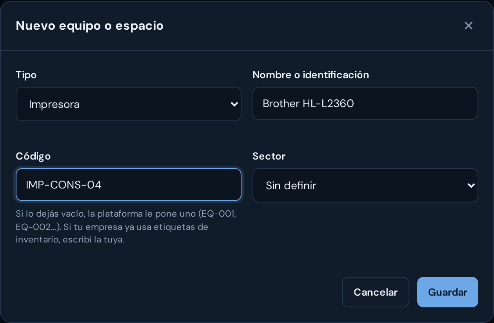

**Editar es del Administrador**: cada cambio de nombre, código, sector o
estado queda registrado automáticamente en el panel **Cambios**, con el valor
anterior y el nuevo. No conviene crear uno nuevo al reemplazar un equipo: se
edita el existente y el historial guarda lo que había antes. El botón
**Eliminar** está dentro de *Editar*; los tickets asociados no se borran.

---

## Sectores, turnos y categorías

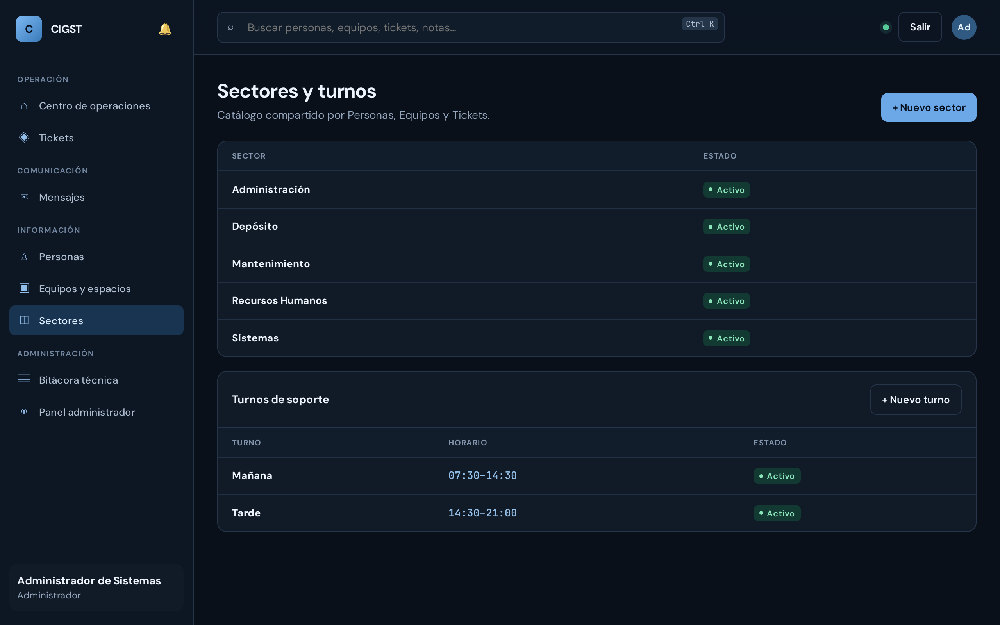

Las áreas de la empresa. El detalle de un sector muestra:

- Sus **personas** y sus **equipos y espacios** (clickeables, útil cuando
  dos se llaman igual en sectores distintos).
- Sus **categorías de ticket**: las que van a aparecer al crear un ticket
  dirigido a ese sector. Un Administrador las agrega y elimina desde ahí
  mismo. Ejemplo: Sistemas puede tener "Hardware", "Red / conectividad";
  Mantenimiento, "Arreglar", "Modificación"; y cada área las suyas.

Con **+ Agregar persona a este sector** se da de alta a alguien sin salir de
la pantalla: el sector viene precargado y al guardar seguís donde estabas.

Al eliminar una categoría, los tickets que ya la usaron **no se modifican**
— simplemente deja de ofrecerse para tickets nuevos.

**Eliminar un sector** se hace desde *Editar*. Si todavía tiene gente o
equipos adentro, la plataforma no lo borra y avisa cuántos hay: primero se
los mueve a otro sector (o se los deja sin sector) y recién ahí se elimina.
Es a propósito — si no, esas fichas quedarían señalando un sector que ya no
existe.

En la misma pantalla se definen los turnos de soporte. Todo esto lo
administra el Administrador; el Supervisor lo ve.

---

## Mensajes: chat 1 a 1 y grupos

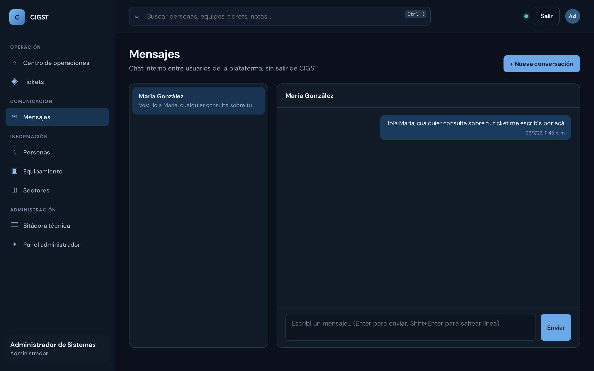

Chateá con cualquier persona de la plataforma. Los **grupos aparecen siempre
primeros** en la lista, con su etiqueta. Enter envía, Shift+Enter baja de
línea, y el badge azul avisa los mensajes sin leer.

Los mensajes llegan **al instante**: no hay que recargar ni esperar. Lo mismo
con los cambios de estado de los tickets y con la campanita. Si se corta el
wifi o se suspende la computadora, al volver se reconecta sola y se pone al
día con lo que pasó mientras tanto — no hay que hacer nada.

El botón 📎 permite **adjuntar archivos** (imágenes, PDF, planillas). Las
imágenes se ven directamente en la conversación; el resto aparece como una
tarjeta para descargar. Se puede mandar un archivo sin escribir nada.

- **Grupos**: los crea el Administrador (+ Nuevo grupo), elige integrantes de
  cualquier rango (cada uno recibe una notificación), y puede editarlos o
  eliminarlos. Al elegir integrantes, **al lado de cada nombre aparece su
  sector** — así no se confunden dos personas que se llaman parecido — y la
  lista viene ordenada alfabéticamente. Todos los integrantes leen y
  escriben; cada mensaje muestra quién lo mandó.
- **Privacidad**: una conversación la ven solo sus participantes y un grupo
  solo sus integrantes. Nadie más — ni siquiera un Administrador que no sea
  parte.

---

## Panel administrador (solo Administradores)

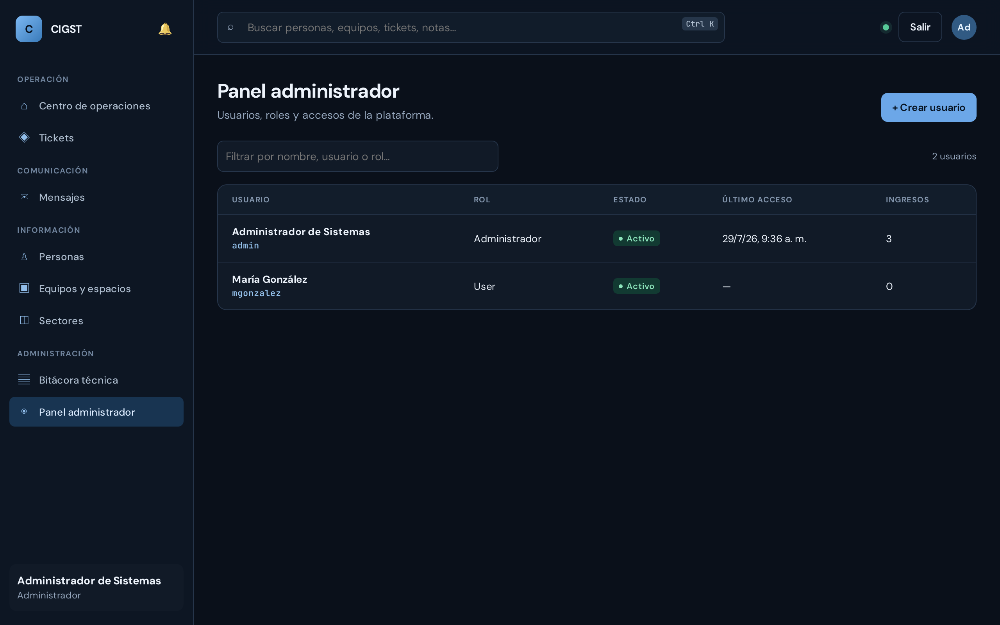

Cuentas de usuario: crear, cambiar rango o contraseña, desactivar o eliminar.
Cada modificación deja su línea en el historial **"Cambios de esta cuenta"**.
La plataforma no permite quedarse sin ningún Administrador activo.

### Avisos que solo ve un Administrador

Arriba de la lista pueden aparecer avisos sobre cómo está funcionando la
plataforma. No son errores: son cosas que conviene que sepa quien administra.

**"Esta conexión no está cifrada"** aparece cuando se entra por HTTP en vez de
HTTPS. Significa que las contraseñas y la sesión viajan legibles por la red de
la empresa. Dentro de una red interna cerrada suele ser aceptable, y por eso la
plataforma no se niega a funcionar — pero es mejor saberlo y decidirlo que
suponer que va cifrado. Cerrarlo del todo es tarea del área de sistemas y está
explicado en la guía de puesta en producción.

El aviso no aparece si entrás desde la propia máquina donde está instalada,
porque ahí el tráfico no sale a la red.

---

## Preguntas frecuentes

**No veo alguna sección de este manual.** Es normal: cada rango ve solo lo
suyo. Si creés que te falta acceso, hablá con un Administrador.

**¿Cómo sé si mi pedido avanzó?** Te llega una notificación cada vez que tu
ticket cambia de estado, y lo ves en "Mis solicitudes".

**Cerré la notebook y al abrirla el chat parecía congelado.** Se reconecta
sola en unos segundos y trae lo que llegó mientras tanto. Si tenés dudas,
recargar la página no rompe nada.

**¿Se pierde algo si se apaga el servidor?** No: los datos quedan guardados.

**¿Quién puede leer mis chats?** Solo los participantes.

**¿La información sale a internet?** No, nunca — con una excepción que
elegís vos: si configurás el **Correo**, el servidor se conecta a tu proveedor
de correo (Gmail, tu hosting, el que sea) para traer y mandar los mensajes.
Son conexiones **salientes**, como las de Outlook: nadie desde internet puede
entrar a la plataforma. Las **Unidades de red** tampoco salen a internet: se
conectan al servidor de archivos de la propia empresa.

🆕 **No veo ninguna unidad de red.** Las asigna un Administrador, a vos o a tu
sector. Pedile la que necesitás.

🆕 **Quise subir un archivo y dice que ya existe.** Nunca se reemplaza un
archivo que ya está en la unidad. Eliminá el que está allá o cambiale el nombre
al tuyo, y volvé a subirlo.

🆕 **¿Por qué para eliminar me pide otra contraseña?** Es la del usuario de la
**unidad de red** (el cuadro te dice cuál), no la de CIGST. Así queda
confirmado quién borra, porque el archivo desaparece para todos.

🆕 **La unidad dice "Con error".** Casi siempre cambiaron la contraseña en el
servidor de archivos. Un Administrador la actualiza en *Administrar unidades →
Editar*.

**Pegué una captura en el chat con Ctrl+V y no pasó nada.** Tiene que estar el
cursor en el cuadro de escribir. Si copiaste texto en vez de una imagen, se
pega como texto (que es lo correcto).

**Mi casilla dice que la contraseña está mal y estoy seguro de que no.** Si es
Gmail o Yahoo, la contraseña normal de la cuenta no sirve: hace falta una
«contraseña de aplicación». Si es Microsoft 365, quien administre el correo
tiene que habilitar el acceso IMAP/SMTP para esa casilla.

**Pegué una tabla de Excel y no se armó.** Tiene que ser un bloque de
**Tabla**, y hay que pegar adentro de un casillero de esa tabla. Si copiaste
una sola celda, se pega como texto normal (es lo esperado).

**No veo una base de conocimiento que sí existe.** No te dieron permiso. Un
Administrador te lo da desde *Bases de conocimiento → la base → Permisos*.

**Publiqué para un sector y alguien de otro sector la vio.** Los
Administradores ven todo el feed a propósito, para poder auditar lo que se
publica. Fuera de eso, nadie más la ve.

**Aparece "En línea" alguien que no está.** El estado sale del **horario
cargado en su ficha**, no de si tiene la plataforma abierta: dice que está
dentro de su franja laboral. Si el horario cambió, se corrige en la ficha.

**Al crear un ticket el Sector aparece vacío.** Es a propósito: el *Sector a
requerir* es a quién le pedís la ayuda, y eso lo elegís vos. No se deduce de
dónde está la persona ni el equipo.

**El desplegable de Categoría dice "Elegí primero el sector a requerir".**
Las categorías las define cada sector, así que primero se elige el sector.
Si dice "Este sector no tiene categorías cargadas", un Administrador puede
agregárselas desde Sectores → el sector → *Categorías de ticket*.

**No me deja borrar un sector.** Tiene personas o equipos adentro; el aviso
dice cuántos. Movelos a otro sector (o dejalos sin sector, eligiendo "Sin
definir" en su ficha) y después sí se elimina.

**Borré una persona: ¿se fueron sus tickets?** No. Los tickets quedan con su
nombre para no perder el historial.

**No encuentro el botón Eliminar.** Está adentro de **Editar**, y solo lo ve
un Administrador. Tu propia cuenta de usuario no ofrece eliminarse.

---

## Usar la plataforma desde el celular

La plataforma se adapta a pantallas chicas. En un teléfono la barra lateral
no entra al costado, así que se convierte en un **cajón** que se abre con el
botón ☰ de arriba a la izquierda.

- Tocás ☰ y aparecen todas las secciones.
- Al elegir una, el cajón se cierra solo.
- También se cierra tocando fuera o con la tecla Escape.

Las tablas **no esconden columnas**: se desplazan de costado con el dedo, así
que no se pierde ningún dato por estar mirando desde el teléfono.

🆕 En **Unidades de red** cada archivo aparece como una tarjeta, con sus
botones *Descargar* y *Eliminar* a la vista, sin desplazar nada.

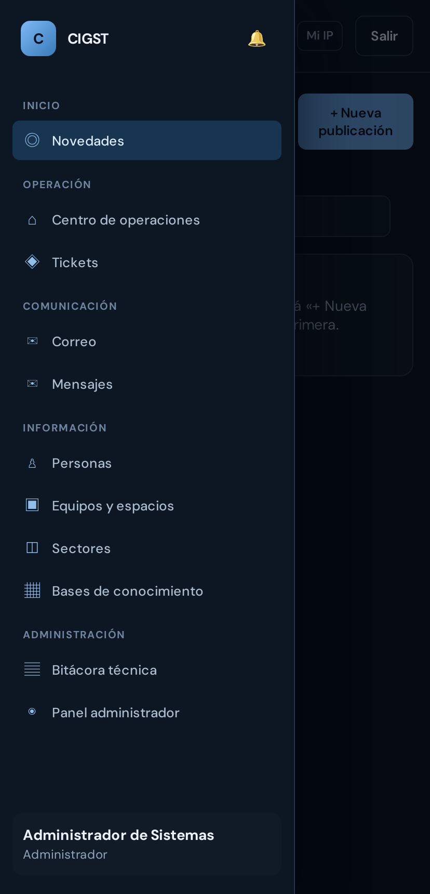

---

## Si el almacenamiento se llena

La plataforma controla cuánto espacio ocupan los archivos adjuntos. Cuando se
acerca al límite empieza a avisar en el registro, y si lo alcanza deja de
aceptar **archivos nuevos** con un mensaje que lo explica.

Lo importante: **no se pierde nada de lo que ya estaba**. Todos los archivos
anteriores siguen ahí y se pueden abrir y descargar igual; lo único que no se
puede hacer es subir más hasta liberar lugar.

Para liberar espacio, un administrador tiene la opción **9) Liberar espacio**
del instalador, que borra únicamente datos sin uso (ver el manual de
instaladores). Si aun así hace falta más lugar, se amplía el límite en el
archivo `.env` con `UPLOADS_MAX_GB`.

### Por qué las imágenes ocupan poco

Cada imagen que entra a la plataforma se **comprime dos veces**: una en tu
navegador, antes de subirla (así viaja poco por la red), y otra en el
servidor, para que también entren comprimidas las que lleguen por otro medio.
Se reduce a 1600 píxeles de lado máximo y se guarda en formato WEBP.

En la práctica una captura de pantalla típica pasa de unos 350 KB a 85 KB: ocupa
**cuatro veces menos** sin que se note la diferencia al mirarla. Los PDF, las
planillas y los GIF animados **no se tocan**: quedan exactamente como los
subiste.

---

## Contraseñas

Al crear un usuario o cambiarle la contraseña, la plataforma pide que sea
razonablemente fuerte:

- **Al menos 10 caracteres.**
- Que combine **al menos tres** de estos cuatro tipos: minúsculas,
  mayúsculas, números y símbolos.
- Sin secuencias tipo `1234` o `abcd`, sin el mismo carácter cuatro veces
  seguidas, y que no contenga el nombre de usuario.
- No se aceptan las contraseñas más usadas del mundo (`password`,
  `12345678` y compañía): son las primeras que prueba cualquiera.

No hace falta inventar algo impronunciable. Una frase corta con un número y
un guion cumple de sobra y se recuerda sola: `Roble-Verde-72`.

Si alguien se equivoca **8 veces seguidas** con la misma cuenta, esa cuenta
queda bloqueada 15 minutos. Es lo que impide que alguien pruebe contraseñas
una tras otra. Un administrador puede restablecer la contraseña desde el
Panel administrador sin esperar ese rato.
